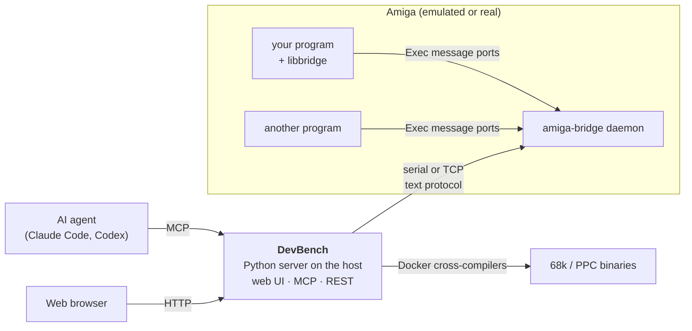

<!-- SPDX-License-Identifier: MIT -->
<!-- Copyright (c) 2026 Chris Collins <chris@hitorro.com> -->

<p align="center">
  
</p>

# Amiga DevBench

**Write, build, run and debug Amiga software from your Mac, Linux or Windows
machine, by hand or with an AI coding agent.**

DevBench links a modern computer to an Amiga, whether that's an emulator or
real hardware. You write C on the host. DevBench cross-compiles it in Docker,
copies it to the Amiga and starts it. While it runs, you can watch its logs,
read and change its variables, call functions inside it, take screenshots,
inject keystrokes and step through it in a debugger.

It does all of this through two front ends at once:

- **A web dashboard** for people: logs, files, memory, tasks, copper lists,
  sprites, screenshots, a shell and a debugger, in the browser.
- **An MCP server** with about 200 tools for AI agents such as Claude Code and
  Codex. An agent can do the whole inner loop itself: edit, build, deploy,
  run, look at the screen, read the logs and fix the bug.

It supports two Amigas:

| | Classic Amiga | AmigaOS 4 |
|---|---|---|
| CPU | 68k (68020 and up) | PowerPC |
| OS | AmigaOS 3.x | AmigaOS 4.1 Final Edition |
| Emulator | FS-UAE, WinUAE, AmiKit, Amiberry | QEMU `sam460ex` |
| Real hardware | over serial or TCP | over TCP |

## What people have built with it

Over 60 programs in [`examples/`](https://github.com/geekychris/amiga_games)
were written with DevBench, most of them with an AI agent driving it. They
include arcade games, 3D games, demos and tools:

<p align="center">
  
</p>

On AmigaOS 4 the same loop produced software-rendered OpenGL games, a port of
Python 3.12, a PDF viewer and a network driver:

<p align="center">
  
</p>

The [portfolio](portfolio/README.md) has screenshots and a write-up of each one.

## The dashboard

Each target gets its own dashboard, colour-coded so you always know which
Amiga you're talking to: orange for AmigaOS 4, blue for classic. It shows the
connection, free memory, the programs connected to the bridge and everything
the bridge can do.

<p align="center">
  
</p>

Programs log through the bridge, and their messages appear live, filtered by
program and level. Here a 3D flight game reports its frame rate and position
while it plays:

<p align="center">
  
</p>

The inspectors read the machine itself. On a classic Amiga that includes the
running copper list, the palette and the hardware sprites, as well as tasks,
libraries, devices, windows and screens on both targets:

<p align="center">
  
</p>

## What you can do

- **Build and run.** One call compiles a project for 68k or PowerPC in
  Docker, deploys it and starts it on the Amiga. New projects come from
  templates.
- **Watch and change a running program.** Programs link a small client
  library. With it they log messages, publish variables you can read and set
  while they run, register hooks you can call from the host, and expose
  memory regions.
- **Test.** A test harness in the client library (`ab_test_begin`,
  `AB_ASSERT`) reports results to DevBench, so an agent can run a game's
  tests and read the results.
- **Look at the screen.** Screenshots, palette, copper list, sprites, bitmaps
  and IFF images, plus a visual diff between two captures.
- **Drive the machine.** Inject keys and mouse moves, run AmigaDOS commands
  and ARexx, browse and transfer files, edit the startup-sequence, manage
  windows and screens, share the clipboard.
- **Debug.** Use the bridge's source-level debugger for your own programs.
  WinUAE's built-in debugger works from a program's first instruction, with
  symbols from DWARF. A patched FS-UAE adds CPU-level debugging. SnoopDos-style
  tracing shows which libraries, devices and files a program opens.
- **Share the emulator safely.** When an agent tests on an emulator you're
  also using, it takes a lock and shows a "CLAUDE IS TESTING" banner on the
  Amiga's screen until it's done.

## How it works



- **`amiga-bridge/`** is a small daemon that runs on the Amiga. It owns the
  serial port (or a TCP socket), answers over 100 commands from the host and
  passes messages between the host and your programs.
- **`amiga-bridge/client/`** is `libbridge.a`, the library your programs link
  to talk to the bridge (`ab_init`, `AB_I`, `ab_register_var`, `ab_poll`, …).
- **`amiga-devbench/`** is the Python server on your computer. It talks to
  the bridge, runs the cross-compilers and serves the web UI and MCP from one
  process.

## Get started

You need Python 3.10+, Git and Docker, plus an emulator with your own
Kickstart ROM and AmigaOS. The ROMs and AmigaOS are commercial and aren't
included. A built-in simulator lets you try DevBench with no Amiga at all.

```sh
git clone --recurse-submodules https://github.com/geekychris/amiga_mcp
cd amiga_mcp
scripts/setup.sh     # install everything that can be installed (68k, os4 or both)
scripts/doctor.sh    # check every prerequisite; each problem comes with its fix
scripts/start.sh     # start the emulators and DevBenches, wait until the Amigas answer
```

Then open `http://localhost:3000/` (AmigaOS 4) or `http://localhost:3001/`
(classic). To try it without an Amiga, run `python3 -m amiga_devbench --simulator`.

To give an AI agent the tools, register the launcher. It starts DevBench if it
isn't running yet:

```sh
claude mcp add amiga-dev -- python3 -m amiga_devbench.mcp_stdio --project-root "$PWD"
```

The scripts are bash. On Windows, use WSL or `scripts/install.ps1`.

## Documentation

| I want to… | Read |
|---|---|
| Set up and start everything with the scripts | [SETUP.md](SETUP.md) |
| Install from a checkout and verify it works | [Installation guide](docs/quickstart.md) |
| Connect Claude Code or Codex | [MCP client setup](docs/using-the-mcp.md) |
| See every MCP tool | [MCP tools](docs/mcp-tools.md) |
| Use the web dashboard | [Web UI](docs/web-ui.md) |
| Write a program that uses the bridge | [Examples and programming guide](docs/examples.md) |
| Connect an emulator or a real Amiga | [Target setup](docs/targets.md) |
| Use WinUAE or FS-UAE | [Dual-emulator setup](docs/winuae-and-fsuae.md) |
| Set up AmigaOS 4.1 on QEMU | [AmigaOS 4 setup](docs/amigaos4-setup.md) |
| Choose a debugger | [Debugger guide](docs/debuggers.md) · [WinUAE debugger](docs/winuae-debugger.md) |
| Understand the design | [Architecture](docs/architecture.md) · [Bridge protocol](docs/bridge-reference.md) |
| Find anything else | [Documentation index](docs/README.md) |

The old `mcp-server/` (TypeScript) and `amiga-debug-lib/` are deprecated and
replaced by `amiga-devbench/` and the bridge client library.

[MIT license](LICENSE)
