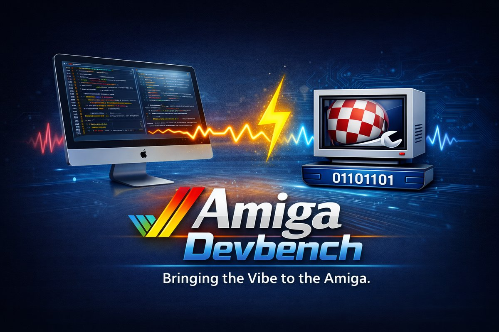
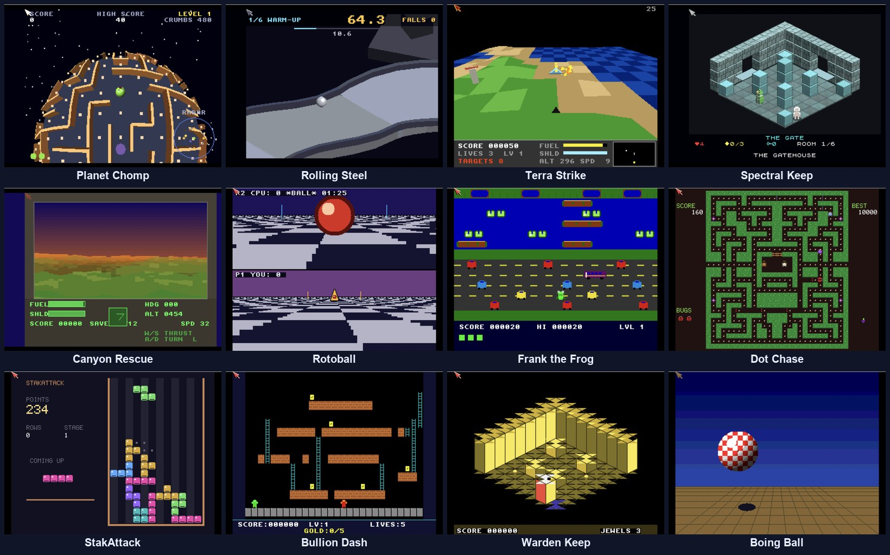
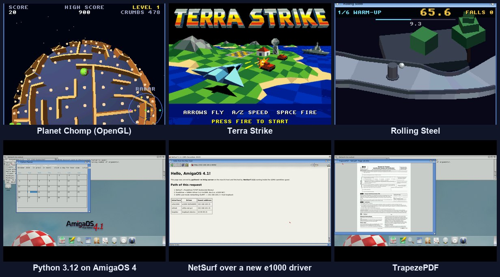
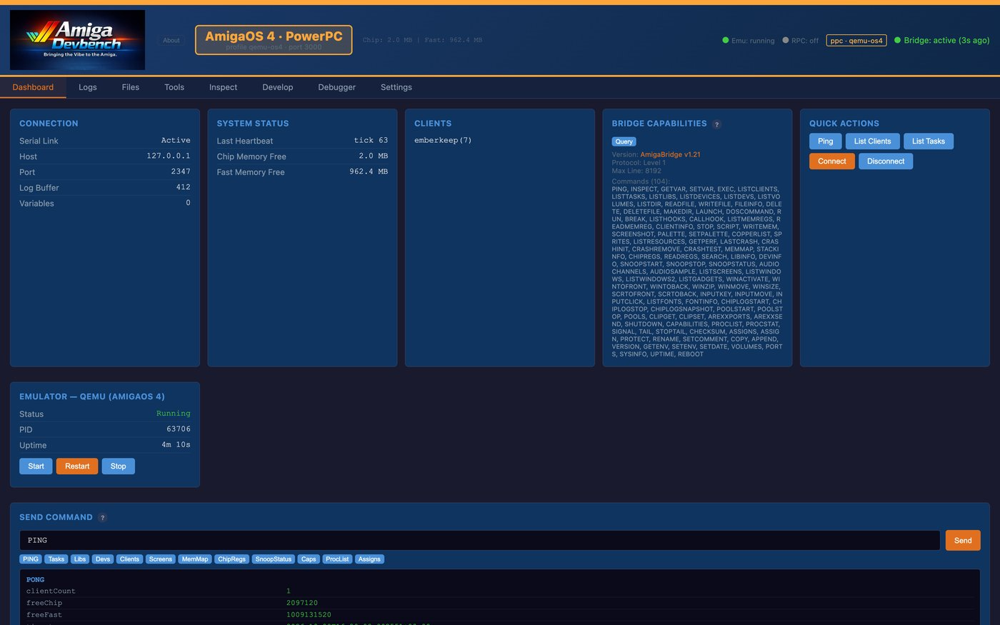
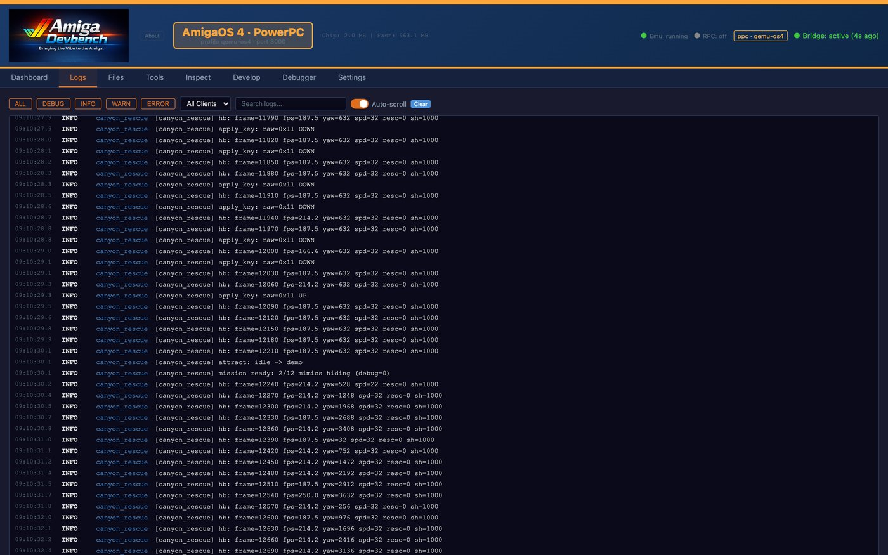
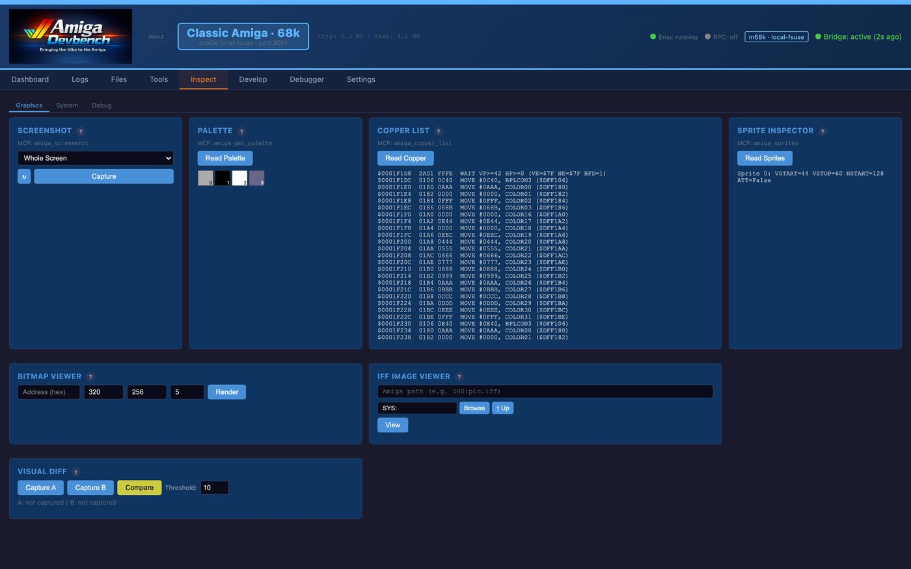
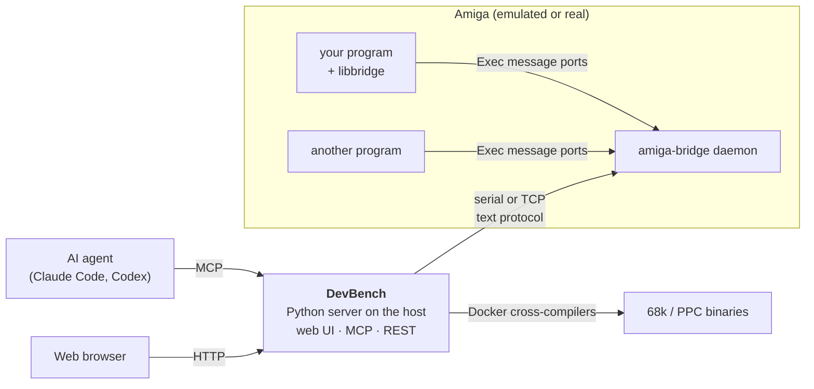

<!-- SPDX-License-Identifier: MIT -->
<!-- Copyright (c) 2026 Chris Collins <chris@hitorro.com> -->

<p align="center">
  
</p>

# Amiga DevBench

**Write, build, run and debug Amiga software from your Mac, Linux or Windows
machine, by hand or with an AI coding agent.**

DevBench links a modern computer to an Amiga, whether that's an emulator or
real hardware. You write C on the host. DevBench cross-compiles it in Docker,
copies it to the Amiga and starts it. While it runs, you can watch its logs,
read and change its variables, call functions inside it, take screenshots,
inject keystrokes and step through it in a debugger.

It does all of this through two front ends at once:

- **A web dashboard** for people: logs, files, memory, tasks, copper lists,
  sprites, screenshots, a shell and a debugger, in the browser.
- **An MCP server** with about 200 tools for AI agents such as Claude Code and
  Codex. An agent can do the whole inner loop itself: edit, build, deploy,
  run, look at the screen, read the logs and fix the bug.

### Why

Traditional Amiga development is hard going. There is no source-level
debugger on the target, a stock machine has no network, and one bad pointer
takes down the whole OS. DevBench puts a modern machine in charge: the Amiga
becomes a build target you can see into and control from outside, even while
it's crashing.

The bigger aim is to make the Amiga community productive with AI. An agent
with DevBench's tools can write an Amiga program, run it, watch it fail and
fix it without a person typing on the Amiga at all. Most of the programs below were made
that way.

It supports two Amigas:

| | Classic Amiga | AmigaOS 4 |
|---|---|---|
| CPU | 68k (68020 and up) | PowerPC |
| OS | AmigaOS 3.x | AmigaOS 4.1 Final Edition |
| Emulator | FS-UAE, WinUAE, AmiKit, Amiberry | QEMU `sam460ex` |
| Real hardware | over serial or TCP | over TCP |

## What people have built with it

Over 60 programs in [`examples/`](https://github.com/geekychris/amiga_games)
were written with DevBench, most of them with an AI agent driving it. They
include arcade games, 3D games, demos and tools:

<p align="center">
  
</p>

On AmigaOS 4 the same loop produced software-rendered OpenGL games, a port of
Python 3.12, a PDF viewer and a network driver:

<p align="center">
  
</p>

The [portfolio](portfolio/README.md) has screenshots and a write-up of each one.

## The dashboard

Each target gets its own dashboard, colour-coded so you always know which
Amiga you're talking to: orange for AmigaOS 4, blue for classic. It shows the
connection, free memory, the programs connected to the bridge and everything
the bridge can do.

<p align="center">
  
</p>

Programs log through the bridge, and their messages appear live, filtered by
program and level. Here a 3D flight game reports its frame rate and position
while it plays:

<p align="center">
  
</p>

The inspectors read the machine itself. On a classic Amiga that includes the
running copper list, the palette and the hardware sprites, as well as tasks,
libraries, devices, windows and screens on both targets:

<p align="center">
  
</p>

## What you can do

- **Build and run.** One call compiles a project for 68k or PowerPC in
  Docker, deploys it and starts it on the Amiga. New projects come from
  templates.
- **Watch and change a running program.** Programs link a small client
  library. With it they log messages, publish variables you can read and set
  while they run, register hooks you can call from the host, and expose
  memory regions.
- **Test.** A test harness in the client library (`ab_test_begin`,
  `AB_ASSERT`) reports results to DevBench, so an agent can run a game's
  tests and read the results.
- **Look at the screen.** Screenshots, palette, copper list, sprites, bitmaps
  and IFF images, plus a visual diff between two captures.
- **Drive the machine.** Inject keys and mouse moves, run AmigaDOS commands
  and ARexx, browse and transfer files, edit the startup-sequence, manage
  windows and screens, share the clipboard.
- **Debug.** Three debuggers (below), plus crash reports that map a Guru
  Meditation back to your source line, a disassembler, and SnoopDos-style
  tracing of the libraries, devices and files a program opens.
- **Share the emulator safely.** When an agent tests on an emulator you're
  also using, it takes a lock and shows a "CLAUDE IS TESTING" banner on the
  Amiga's screen until it's done.

### A program DevBench can see into

A program links `libbridge.a` and adds a few calls. Everything it registers
shows up in the web UI and in the MCP tools by name:

```c
#include "bridge_client.h"

static LONG difficulty = 3;
static BOOL running = TRUE;

static int set_difficulty(const char *args, char *result, int size)
{
    difficulty = atol(args);
    sprintf(result, "difficulty=%ld", (long)difficulty);
    return 0;
}

int main(void)
{
    ab_init("game");                                      /* connect to the bridge */
    ab_register_var("difficulty", AB_TYPE_I32, &difficulty);
    ab_register_hook("set_difficulty", "1-10", set_difficulty);
    AB_I("started, difficulty %ld", (long)difficulty);    /* a live log line */

    while (running) {
        ab_poll();               /* answer the host once per frame */
        /* ... the game ... */
    }
    ab_cleanup();
    return 0;
}
```

From the host you can then read or set `difficulty` while the game runs
(`amiga_get_var`, `amiga_set_var`), or call `set_difficulty` with an argument
(`amiga_call_hook`). The [programming guide](docs/examples.md) covers memory
regions, the test harness and the AmigaOS C pitfalls.

### The loop with an AI agent

1. The agent writes or edits the C source on your computer.
2. `amiga_build_deploy_run` cross-compiles it, copies it to the Amiga and
   starts it.
3. `amiga_watch_logs`, `amiga_get_var` and `amiga_screenshot` show what it
   does. `amiga_input_key` plays it.
4. If it crashes, `amiga_last_crash` and `amiga_load_symbols` give the alert,
   the registers and the source line.
5. The agent fixes the code and goes round again. `amiga_run_tests` runs the
   program's own tests at the end.

### Three debuggers

| | Bridge debugger | WinUAE debugger | FS-UAE debugger |
|---|---|---|---|
| Question it answers | What is my program doing? | What does my program do from its first instruction? | What is the emulated machine doing? |
| Runs in | the bridge on the Amiga | WinUAE's built-in GDB server | a [patched FS-UAE](https://github.com/geekychris/fsuae_remote_patch) |
| Source lines, locals, call stack | yes | yes, from DWARF | addresses and symbols |
| Hardware watchpoints, Kickstart ROM | no | yes | yes |
| Works after the OS has crashed | no | yes | yes |
| Targets | 68k | 68k | 68k |

On AmigaOS 4, QEMU's GDB stub fills the same role (`scripts/gdb-os4.sh`).
They work side by side: use an emulator watchpoint to find *where* memory
gets overwritten, then the bridge debugger to step through the code around
it. The [debugger guide](docs/debuggers.md) has the details.

## How it works



- **`amiga-bridge/`** is a small daemon that runs on the Amiga. It owns the
  serial port (or a TCP socket), answers over 100 commands from the host and
  passes messages between the host and your programs.
- **`amiga-bridge/client/`** is `libbridge.a`, the library your programs link
  to talk to the bridge (`ab_init`, `AB_I`, `ab_register_var`, `ab_poll`, …).
- **`amiga-devbench/`** is the Python server on your computer. It talks to
  the bridge, runs the cross-compilers and serves the web UI and MCP from one
  process.

### Where the Amiga can be

The same bridge runs everywhere; only the link and the deploy route differ.
A profile in `devbench.toml` holds each setup, and you switch with
`--profile`.

| Setup | Link to DevBench | How programs get there |
|---|---|---|
| FS-UAE or AmiKit on this computer | emulated serial port over TCP or a PTY | shared folder |
| WinUAE on this computer | TCP from the guest's network stack | the guest's boot folder |
| AmiKit in Amiberry on a Raspberry Pi | TCP on the LAN | the bridge's file transfer |
| A real Amiga | serial cable, or TCP with RoadShow / AmiTCP | the bridge's file transfer |
| AmigaOS 4.1 in QEMU (`sam460ex`) | emulated serial port over TCP | written into the dev hard file |

You can run several at once, one DevBench per Amiga: `scripts/start.sh`
starts the AmigaOS 4 one on port 3000 and the classic one on port 3001.

## Setup

**New here? [Install and verify DevBench](docs/quickstart.md).**
The guide works from an existing checkout and starts with a simulator, so
you can verify the host installation before setting up an Amiga.

### What you need

- **Host server:** Python 3.10+ and Git, on macOS, Linux or Windows.
- **A real target:** an emulator with your own ROM/OS, or an Amiga, running
  the `amiga-bridge` guest program. The simulator needs neither.
- **Compiling Amiga programs:** Docker and the appropriate cross-compiler
  image. Docker is not needed just to install the Python server or inspect
  a target with an existing bridge.

### Setup in three commands

```sh
git clone --recurse-submodules https://github.com/geekychris/amiga_mcp
cd amiga_mcp
scripts/setup.sh     # install everything that can be installed (68k, os4 or both)
scripts/doctor.sh    # check every prerequisite; each problem comes with its fix
scripts/start.sh     # start the emulators + devbenches, wait until the Amigas answer
```

To pick a machine from a full-screen menu instead (classic Amiga, AmigaOS 4,
Atari ST and 3DO), run `make retro`. It runs the Retro Launcher from
`../retro-launcher`.

The Kickstart ROM and the AmigaOS 3.x / 4.1 installs are commercial, so
`doctor.sh` keeps reporting them until they're in place; it says where each
goes. The scripts are bash: on Windows, use WSL (or `scripts/install.ps1`).
See **[SETUP.md](SETUP.md)** for the one-page guide.

The current server is in `amiga-devbench/` (Python). The `mcp-server/`
TypeScript project and `amiga-debug-lib/` are deprecated.

### Start here

| I want to… | Read |
|---|---|
| Set up and start everything with the scripts | [SETUP.md](SETUP.md) |
| Install from a checkout and verify it works | [Installation guide](docs/quickstart.md) |
| Connect Codex CLI or Claude Code | [MCP client setup](docs/using-the-mcp.md) |
| Use WinUAE or FS-UAE | [Dual-emulator setup](docs/winuae-and-fsuae.md) |
| Connect an emulator or physical Amiga | [Target setup](docs/targets.md) |
| Set up AmigaOS 4.1 on QEMU | [AmigaOS 4 setup](docs/amigaos4-setup.md) |
| Use WinUAE native debugging | [WinUAE debugger](docs/winuae-debugger.md) |
| Choose between guest and emulator debugging | [Debugger guide](docs/debuggers.md) |
| Automate the install | [Scripted installer](docs/installer.md) |
| See every MCP tool | [MCP tools](docs/mcp-tools.md) |
| Use the web dashboard | [Web UI](docs/web-ui.md) |
| Write a program that uses the bridge | [Examples and programming guide](docs/examples.md) |
| Understand the design | [Architecture](docs/architecture.md) · [Bridge protocol](docs/bridge-reference.md) |
| Find a tool or API | [Documentation index](docs/README.md) |

### How it fits together

```text
Codex / Claude Code ── MCP over HTTP ──┐
                                     ├── DevBench ── serial/TCP ── amiga-bridge
Web browser ───────── HTTP ───────────┘                              (Amiga)
```

The dashboard is at `http://localhost:3000/`; the MCP endpoint is
`http://localhost:3000/mcp`. `scripts/start.sh` runs one DevBench per target:
AmigaOS 4 on port 3000 and classic 68k on port 3001. DevBench must stay
running while clients use it.

An MCP client can instead run the launcher, which starts DevBench if nothing
is listening on its port yet:

```sh
claude mcp add amiga-dev -- python3 -m amiga_devbench.mcp_stdio --project-root "$PWD"
```

To try DevBench without an Amiga, run `python3 -m amiga_devbench --simulator`.

Most guest tools work through the bridge. Native [WinUAE debugging](docs/winuae-debugger.md)
uses WinUAE's built-in GDB server. Emulator-level `amiga_fsuae_*`
tools separately require [patched FS-UAE](https://github.com/geekychris/fsuae_remote_patch).
Installing the Python server does not install an emulator, ROM or AmigaOS.

[Browse the examples](docs/examples.md) · [Architecture](docs/architecture.md) ·
[Scripted installer](docs/installer.md) · [MIT license](LICENSE)
